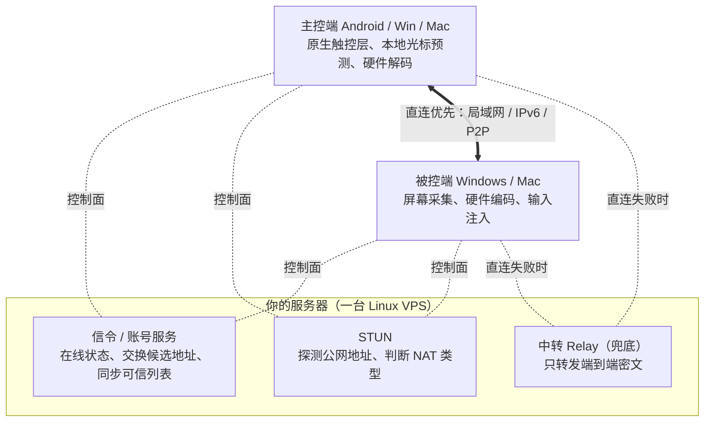

# 灵犀 Lingxi Desk 技术方案

> 自研跨端远程桌面。文档同步自方案文档，最后更新 2026-11-20。

## 摘要

建议以 RustDesk 为底座二次开发，重写三块它做得不够好的地方：手机端触控输入层、设备信任与免密连接、连接策略；再借鉴 Sunshine 的低延迟视频管线做“性能模式”。这样能在约 3 到 4 个月内（单人估算）拿到可日常使用的版本，而不是从零造协议栈。

关键决策：

- **连接**：自动模式下局域网、IPv6 直连、P2P 打洞、中转四路并行竞速，谁先通用谁；设置里可强制“仅直连”或“仅中转”。
- **账号**：不用短信。每台设备安装时生成自己的密钥对，第一次扫码加入你的设备组，之后同组设备互控免 PIN、免密码。
- **手机鼠标**：默认触控板模式；灵敏度按手机物理尺寸（毫米）和当前缩放倍率计算，带可调加速曲线、亚像素累积；光标在手机本地即时绘制，再与被控端位置校正，消除“拖着走”的延迟感。
- **画质**：分辨率、帧率、编码可调，最高 4K60；H.265 为默认，支持时用 AV1，文字场景可开 4:4:4。

## 需求与范围

第一版只做“控制电脑”，手机只当主控端。

| 主控 \ 被控 | Windows | macOS |
| --- | --- | --- |
| Android | 支持（重点体验） | 支持（重点体验） |
| Windows | 支持 | 支持 |
| macOS | 支持 | 支持 |

非目标（第一版不做）：控制手机、iOS 主控、Linux、文件云同步、多人协作。iOS 主控后续可以复用 Android 的输入设计。

体验指标（目标值，待实测校准）：

| 指标 | 局域网 | 公网 P2P | 中转 |
| --- | --- | --- | --- |
| 画面端到端延迟 | ≤ 40 ms | RTT + 40 ms | RTT + 50 ms |
| 本地光标响应 | ≤ 1 帧（本地绘制） | 同左 | 同左 |
| 最高画质 | 4K60，50–100 Mbps | 自适应，常见 1080p–2K | 受服务器带宽限制 |
| 建连时间 | ≤ 1 s | ≤ 3 s | ≤ 3 s |

其他必须项：无人值守（电脑开机未登录也能连）、剪贴板同步、声音、多显示器切换、文件传输。

## 开源方案对比与选型

结论：Fork RustDesk（客户端 + 服务端），借鉴 Sunshine/Moonlight 的视频与传输设计。

| 方案 | 协议/许可 | 强项 | 弱项 | 用法 |
| --- | --- | --- | --- | --- |
| [RustDesk](https://github.com/rustdesk/rustdesk) | AGPL-3.0，Rust + Flutter | 三端被控/主控齐全、自建服务器（hbbs 信令 + hbbr 中转）、局域网发现、硬件编码 | 安卓触控手感一般、开源版账号体系简陋、低延迟不如 Sunshine | **底座** |
| [Sunshine](https://github.com/LizardByte/Sunshine) + [Moonlight](https://github.com/moonlight-stream) | GPL-3.0 | 局域网延迟极低：UDP + Reed-Solomon FEC、NVENC/AMF/QSV 低延迟参数、虚拟显示器、一次 PIN 配对后证书免密 | 无公网打洞、无账号、桌面办公功能少、Mac 被控实验性 | **借鉴**视频管线与配对思路 |
| ToDesk / UU 远程 / 向日葵 | 商业闭源 | 国内节点多、开箱即用 | 收费、不可自建、手机鼠标一般 | 参考交互 |
| Parsec | 商业闭源 | 自研 UDP 协议延迟低 | 安卓端弱、国内网络一般 | 参考 |

许可：本项目基于 RustDesk，按 AGPL-3.0 开源。Sunshine 为 GPL-3.0，只借鉴设计、自行实现。

备选路线：如需标准化的 ICE/拥塞控制，可用 WebRTC（libwebrtc 或 webrtc-rs）重写传输层，上层模块不变。

## 整体架构

服务器只做“撮合”和“兜底”，画面和输入尽量在两台设备之间直接走。



两台设备都先向信令服务注册并用 STUN 探测公网地址，由信令交换候选地址后尝试直连；只有直连全部失败时才走中转。服务器宕机时，同一局域网的设备仍可靠 mDNS 互相发现并连接。

终端内部分三层：平台层（采集、编解码、输入注入）、核心层（Rust：连接管理、加密、协议、码率控制）、界面层（Flutter，Android 的触控和光标图层用原生代码）。

## 网络连接

自动模式下所有候选路径同时竞速，先通的先用，更优的通了再无缝切过去。中转能在 1 秒内先出画面，P2P 打通后再切到直连。

### 候选路径与优先级

| 优先级 | 路径 | 怎么拿到地址 | 说明 |
| --- | --- | --- | --- |
| 1 | 局域网直连 | mDNS/DNS-SD 广播 + 信令交换的内网 IP | 双方公网 IP 相同则内网候选提前；服务器挂了也能用 |
| 2 | IPv6 直连 | 设备上报自己的公网 IPv6 | 国内宽带和 4G/5G 大多有 IPv6，成功率往往高于 IPv4 打洞 |
| 3 | IPv4 端口映射 | UPnP / NAT-PMP / PCP | 成功即等同公网直连 |
| 4 | IPv4 UDP 打洞 | STUN 得到映射地址，双向同时发包 | 锥型 NAT 基本能通；双对称型基本失败 |
| 5 | 中转 | 自建 relay | 一定能通；画质上限 = 服务器带宽 |

### 设置项

- **自动（默认）**：五条并行竞速，连接中每 30 秒尝试升级到更优路径。
- **仅直连**：只用 1–4，不走服务器流量，打不通就报错并说明 NAT 类型。
- **仅中转**：只用 5；可回退到 TCP/443。
- **指定地址**：手动填 IP:端口或域名。
- 工具栏显示当前路径、RTT、丢包率、码率。

### 传输协议

全部跑在 UDP 上，用 QUIC（quinn）同时承载可靠流和数据报：

| 通道 | 承载 | 可靠性 |
| --- | --- | --- |
| 视频 | 编码帧分片 | 数据报 + FEC（约 10–20% 冗余，按丢包率动态调），丢帧请求关键帧或参考帧失效 |
| 输入 | 鼠标移动 | 数据报，只发最新绝对位置，丢了不重传 |
| 输入 | 点击、按键、滚轮 | 可靠流，带序号幂等 |
| 音频 | Opus 10 ms 帧 | 数据报 + 小缓冲 |
| 控制 | 剪贴板、文件、光标形状、配置 | 可靠流 |

中转只转发密文。第一阶段沿用 RustDesk 现有协议（TCP + KCP），第二阶段替换为上述 QUIC 方案。

### 服务器需求

一台有公网 IPv4（最好也有 IPv6）的 Linux 服务器，跑信令、STUN、中转。中转带宽决定中转画质：5 Mbps 够 1080p30，10–20 Mbps 够 1080p60 或 2K，4K 中转需 30 Mbps 以上。中转时自动把码率上限压到服务器带宽以内。

## 同账号互控与设备绑定

“账号”本质上是一个“设备组”：组内设备互相信任，连接时靠设备密钥自动互认，不输 PIN、不输密码、不用短信。

### 核心机制

1. 每台设备首次安装时生成 Ed25519 设备密钥对，私钥存入系统安全存储（Android Keystore、macOS Keychain、Windows DPAPI/TPM），永不离开设备。
2. 设备组有一份**可信设备列表**（公钥 + 名称 + 权限），每次变更由组内一台已信任设备签名，服务器只负责同步。服务器被入侵也无法偷加设备。
3. 连接时双方用设备密钥握手（Noise IK 或 TLS 1.3 双向证书），被控端核对对方公钥在可信列表里即放行，并协商端到端会话密钥。
4. 移除设备：在任意可信设备上删除，列表重新签名下发，立即失效。

### 首次连接自己的服务器

开源版不内置任何服务器，每个人连自己部署的服务器。全程只有第一台设备需要填一次。

1. **部署**：VPS 上用 Docker 一条命令启动，输出“服务器连接码”（地址 + 服务器公钥指纹）和二维码。
2. **第一台设备**：首次启动进入引导页，粘贴连接码或扫码，然后创建设备组。客户端固定记住服务器公钥，冒充者直接拒绝。
3. **后续设备**：设备绑定二维码已带服务器连接码，扫一次码即同时配好服务器和设备组。

可选：“仅局域网模式”不连服务器也能在同一网络内配对和互控；自用版可在编译时内置自己的连接码。

### 绑定流程（三选一，都不用短信）

| 方式 | 场景 | 步骤 |
| --- | --- | --- |
| 扫码绑定（主推） | 新设备加入已有组 | 已在组内的设备显示二维码（含服务器连接码、一次性令牌、公钥指纹，5 分钟有效），新设备扫码即完成 |
| 局域网配对 | 两台电脑在同一网络 | 自动发现对方，两边显示同一组 6 位校验码，点“一致” |
| 账号登录 + 旧设备确认 | 不在身边时添加 | 新设备用用户名 + 密码（或 Passkey）登录一次，任意旧设备弹窗同意 |

扫码方向遵循“有摄像头的一方扫”：电脑已在组里时，电脑显示码、新手机扫；手机已在组里时，新电脑显示“申请加入”码、手机扫码后点同意。服务器二维码只用于第一台设备。

第一台设备点“创建我的设备组”，设用户名和密码即可。密码只在“账号登录”方式用到，且需旧设备同意，密码泄露也加不进来。

### 多用户共用服务器与跨组连接

一台服务器可以承载多个用户，每人有自己的设备组。只有同组设备默认免密。跨组连接每次都需要被控方同意，只有被控方在一次连接结束后主动授权，对方下次才能免确认。

1. **邀请制注册**：服务器默认关闭公开注册。管理员生成邀请二维码（服务器连接码 + 一次性邀请令牌），其他人扫码后在该服务器上创建自己的设备组。
2. **添加联系人**：两个组互加联系人后，能看到对方公开的设备。联系人只代表“可以发起请求”，不代表有任何权限。
3. **每次请求都需同意**：被控端弹窗“XX 的 YY 请求控制本机”，可选“允许控制 / 仅允许查看 / 拒绝”，30 秒无响应自动拒绝。被控电脑旁没人时，请求同时推送到被控方组内其他设备（如手机），可远程批准。
4. **断开后询问是否免确认**：连接结束时弹窗“是否允许 XX 的 YY 下次直接连接本机？”，选项为“每次都问我（默认）/ 7 天内免确认 / 一直免确认”，继承本次权限级别。关掉弹窗按“每次都问我”处理。弹窗底部有勾选框“以后不再对此设备弹出此提示”，勾上后保持当前选择、不再询问；也可在设置里全局关闭，或在“已授权的连接”里重新打开。
5. **授权范围**：免确认只绑定“对方这一台设备 → 本机”，不扩展到其他设备。授权记录由被控方设备签名，服务器无法伪造。
6. **免确认连接时**：仍显示“正被 XX 控制”提示条，并通知被控方手机；30 天未使用自动失效（可关）。
7. **管理与撤销**：设置里“已授权的连接”可随时撤销，立即生效。
8. **管理员边界**：可看用户数和中转流量、限速或停用某用户；看不到画面，无法向别人的组添加设备；连别人的设备同样走申请流程，没有特权。

以上规则双方完全对称：谁是被控端，谁弹窗、谁决定是否免确认。两个方向的授权各自独立。

设置里可自定义的开关：

| 开关 | 默认 |
| --- | --- |
| 允许其他人请求连接本机 | 开 |
| 允许授予免确认连接 | 开 |
| 断开后询问是否免确认 | 开 |
| 请求无人响应自动拒绝时间 | 30 秒 |
| 请求同时推送到我的其他设备 | 开 |
| 免确认连接时通知我 | 开 |
| 免确认授权闲置自动失效 | 开，30 天（可改天数） |
| 同组设备免密互控 | 开 |

### 日常使用

- 打开 App 即看到设备列表和在线状态，点一下就连。
- 每台设备可单独设置：只看、可控、是否允许无人值守、是否需要确认。自己的设备默认“可控 + 无人值守 + 无需确认”。
- 临时协助：保留“设备码 + 一次性密码”模式，每次会话后刷新。
- 服务器不可用时，局域网内的可信设备仍能靠本地缓存的可信列表 + mDNS 互连。

实现上，账号/设备服务自己写（Rust axum + SQLite），客户端替换 RustDesk 原有的密码校验流程。

## 手机端虚拟鼠标与触控交互

现有方案“灵敏度不高”通常是五个问题叠加：触摸死区吞掉起始移动、小数位移被取整丢掉、灵敏度按远端像素而不是按你看到的画面算、没有加速曲线、光标要等远端画面回来才动。

### 三种操作模式

| 模式 | 行为 | 适合 |
| --- | --- | --- |
| 触控板模式（默认） | 手机屏幕当触控板，手指移动 = 光标相对移动，点击发生在光标处 | 办公、精确点小按钮、框选 |
| 直接点击模式 | 点哪就点哪；光标显示在手指上方偏移处并带放大镜 | 大按钮界面、快速浏览 |
| 触摸透传模式 | 多点触摸原样注入 Windows（InjectTouchInput） | 支持触摸的 Windows 应用；Mac 不支持 |

### 灵敏度：按“视觉空间”计算

手指移动量先换算成物理距离（毫米，用屏幕 xdpi/ydpi），再映射成手机屏幕上看到的光标位移，最后除以当前缩放倍率得到远端像素。不同手机、不同被控分辨率手感一致；放大画面后光标自动变精细。

```
Δremote = Δfinger_mm × k_px/mm × s × g(v) / z
g(v) = g_min + (g_max − g_min) × smoothstep((v − v1) / (v2 − v1))
```

v 为手指速度（mm/s），s 为灵敏度滑块，z 为缩放倍率。初始值（待实测）：g_min = 1.0，g_max = 3.5，v1 = 40 mm/s，v2 = 300 mm/s。

设置：灵敏度 0.2×–5×；加速曲线 关/轻/中/强/自定义；校准小游戏推荐参数。

### 把丢掉的移动找回来

1. **不吃起始位移**：touch slop 只用于判断点击/移动，判定为移动后补发死区内的位移。
2. **亚像素累积**：浮点计算，小数余量留到下一帧。
3. **吃满采样率**：`View.requestUnbufferedDispatch()` + `MotionEvent.getHistoricalX/Y`，拿到 120–240 Hz 轨迹。
4. **滤抖不加延迟**：One Euro Filter。
5. **点击不跑偏**：轻点时光标锁定在按下位置。

### 光标本地预测渲染

被控端单独发送光标形状和位置，不画进视频。手机端独立图层绘制光标：

1. 手指一动，本地光标当帧就动。
2. 触控板模式下发送远端绝对坐标，避免被控端系统加速二次叠加。
3. 被控端回报实际位置，不符时 50–100 ms 内平滑纠正。
4. 光标被隐藏或锁定（游戏、3D 视角拖动）时自动切换为相对位移并隐藏本地光标。

### 手势表（触控板模式）

| 手势 | 效果 |
| --- | --- |
| 单指滑动 | 移动光标 |
| 单指轻点 | 左键单击 |
| 连续两次轻点 | 双击 |
| 轻点后按住再滑 | 按住左键拖拽 / 框选 |
| 双指轻点 | 右键 |
| 双指滑动 | 滚轮（像素级 + 惯性） |
| 双指捏合 | 本地缩放画面 |
| 三指轻点 | 中键 |
| 三指上滑 / 下滑 | 唤起 / 收起键盘和特殊键栏 |
| 长按后滑动 | 精确模式，灵敏度临时 0.3× |
| 屏幕边缘内滑 | 工具栏 |

全部手势可开关和改绑；另提供悬浮左/右键。

### 视口与缩放

- 捏合缩放，光标靠近边缘时画面跟随平移。
- 弹出输入法时保证光标区域不被挡住。
- 可选按手机屏幕比例创建虚拟显示器。

### 键盘

- 中文：手机输入法上屏后发送 Unicode 文本。
- 特殊键栏：Esc、Tab、Ctrl、Alt/Option、Win/Command、方向键、F1–F12、Ctrl+Alt+Del；修饰键可锁定。
- Win/Mac 快捷键自动映射。

### 外设与输入通道

- 蓝牙鼠标用 Pointer Capture 拿原始相对位移；外接键盘发扫描码。
- 输入不等画面帧，最高 250 Hz 发送，低延迟数据报通道 + DSCP。
- 按键带序号幂等；断开时被控端释放所有按键。

这一层用 Kotlin 原生视图实现，叠在视频 SurfaceView 上，绕开 Flutter 手势延迟。

## 音视频与各平台采集/注入

| 环节 | Windows（被控） | macOS（被控） | Android（主控） | Win/Mac（主控） |
| --- | --- | --- | --- | --- |
| 屏幕采集 | DXGI Desktop Duplication / Windows.Graphics.Capture | ScreenCaptureKit（12.3+） | — | — |
| 编码 | NVENC / AMF / QSV，回退 MF 或软编 | VideoToolbox | — | — |
| 解码 | — | — | MediaCodec 硬解 + KEY_LOW_LATENCY | D3D11VA/NVDEC、VideoToolbox |
| 显示 | — | — | SurfaceView 直出 | D3D11 / Metal |
| 输入注入 | SendInput；InjectTouchInput | CGEventPost（辅助功能授权） | — | — |
| 音频 | WASAPI Loopback | ScreenCaptureKit 音频（13+） | AAudio | 系统音频 API |
| 无人值守 | SYSTEM 服务切入 Winlogon 桌面 | LaunchDaemon + LaunchAgent | — | — |
| 虚拟显示器 | IddCx 间接显示驱动 | CGVirtualDisplay（非公开 API） | — | — |

### 可调参数

| 参数 | 选项 | 默认 |
| --- | --- | --- |
| 分辨率 | 原生 / 4K / 2K / 1080p / 720p / 适配主控屏幕 | 局域网原生，公网自动 |
| 帧率 | 30 / 60 / 90 / 120 | 60 |
| 编码 | 自动 / H.264 / H.265 / AV1 | 自动 |
| 色度 | 4:2:0 / 4:4:4 | 4:2:0 |
| 画质偏好 | 流畅 / 平衡 / 画质 | 平衡 |
| 码率上限 | 自动或 1–150 Mbps | 自动 |

参考码率（H.265，60 fps，桌面内容）：1080p 约 8–15 Mbps，2K 约 15–25 Mbps，4K 约 30–60 Mbps。

### 低延迟要点（借鉴 Sunshine）

- 无 B 帧、无前瞻、单帧 VBV，帧内刷新代替周期关键帧。
- 画面不变不发帧，静止后补一帧高质量帧。
- 丢包靠 FEC 恢复，否则参考帧失效或请求关键帧。
- 主控端不缓存帧，堆积时丢旧帧。

## 安全与隐私

- 全链路端到端加密，包括中转。
- 首次连接校验公钥指纹，之后公钥变化立即告警。
- 被控期间始终显示提示条，可一键断开；可选隐私模式（黑屏）。
- 服务器：登录限流、短期令牌；中转需一次性会话票据。
- 连接日志可在任意设备查看。
- Mac 授权“屏幕录制”和“辅助功能”有分步引导。

## 技术栈、里程碑与风险

### 技术栈

| 部分 | 选型 |
| --- | --- |
| 核心库 | Rust（沿用 RustDesk） |
| 桌面 UI | Flutter（沿用） |
| Android 输入与解码 | Kotlin 原生视图 + MediaCodec |
| 传输 | 先沿用 RustDesk 协议；后期 QUIC（quinn）+ FEC |
| 服务端 | hbbs/hbbr + 自写账号/设备服务（axum + SQLite），Docker 部署 |
| 加密 | Ed25519 设备密钥、Noise/TLS 1.3 |

### 里程碑（单人全职估算，合计约 14–18 周）

| 阶段 | 内容 | 交付标准 | 周数 |
| --- | --- | --- | --- |
| M0 基线 | Fork 并编译三端，部署信令和中转，测量延迟 | 三端互连可用，有基准数据 | 1–2 |
| M1 手机输入 | 原生触控层、两种模式、加速曲线、本地光标预测、手势、键盘栏 | 盲测手感优于 ToDesk/UU | 4–5 |
| M2 设备组 | 设备密钥、扫码绑定、可信列表、免密连接、跨组授权 | 新手机 30 秒内绑定，之后一点即连 | 2–3 |
| M3 连接策略 | 并行竞速、IPv6、UPnP、mDNS、三种模式、路径显示 | 同局域网必走直连 | 2–3 |
| M4 画质 | 分辨率/帧率/编码可调、虚拟显示器、4:4:4、码率自适应 | 局域网 4K60 稳定 | 3 |
| M5 性能与打磨 | QUIC + FEC、无人值守、Mac 引导、自动更新 | 局域网端到端 ≤ 40 ms | 2–3 |

### 风险

| 风险 | 应对 |
| --- | --- |
| 移动网络多为对称型 NAT / CGNAT | 优先 IPv6；中转自动限码率 |
| 服务器带宽小 | 中转只是兜底；可加第二台中转 |
| macOS 权限与登录前界面 | Mac 开自动登录或单独处理登录窗口 |
| 安卓厂商解码延迟差异 | 维护机型参数表（参考 Moonlight） |
| 上游 RustDesk 合并冲突 | 自研模块做成独立 crate，少改上游 |
| AGPL 义务 | 本项目公开开源，已满足 |
